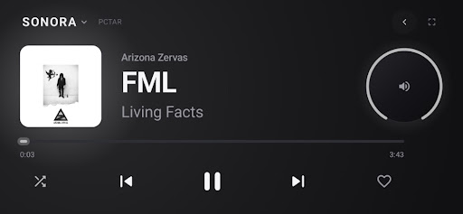
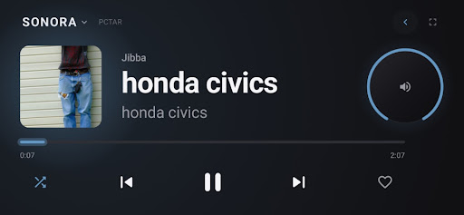
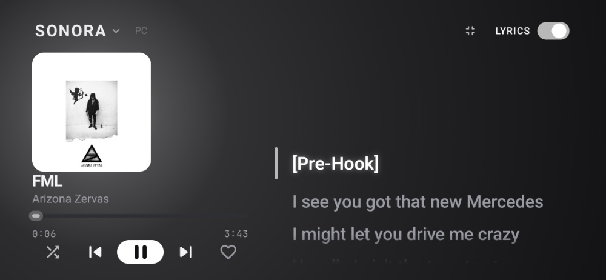
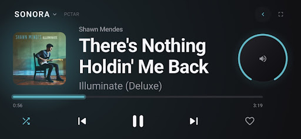

# SONORA

**Your music. Nothing else.**

A distraction-free, hardware-inspired Android music appliance designed for desk docks and standalone playback.

 

 
 

[**Download Latest APK**](https://github.com/SONORA-app/SONORA/releases) • [**View Live Site**](https://sonora-app.github.io/SONORA/) • [**Report an Issue**](https://github.com/SONORA-app/SONORA/issues)

---

## Overview

**SONORA** transforms any Android phone into a dedicated desk audio deck. Engineered without algorithmic clutter, notifications, or social feeds, Sonora strips digital audio playback down to tactile controls and responsive lighting.

Whether mounted horizontally on a charging cradle or carried on the go, Sonora runs as a continuous, ambient listening dashboard.

---

## Key Features

* **Ambient Palette Glow:** Dynamically samples live album art to generate an adaptive backlight glow across your dashboard.
* **Rotary Dial & Tactile Haptics:** Physical audio hardware-inspired circular dial with haptic feedback ticks as you adjust gain.
* **Synchronized Live Lyrics:** Real-time, line-by-line lyric tracking integrated directly into the main playback screen without switching views.
* **OLED Standby Mode:** Low-power burn-in protection displaying an ultra-minimal standby clock and track monitor during idle sessions.
* **Distraction-Free Architecture:** Pure playback deck. No feeds, ads, social integrations, or notification interruptions.

---

## Screenshots

  
  

  
  

---

## Installation

1. Head over to the [**Releases**](https://github.com/SONORA-app/SONORA/releases) page.
2. Download the latest `app-release.apk` file under **Assets**.
3. On your Android device, tap the downloaded APK to install.
   *(You may need to enable **Install unknown apps** for your browser in Android Settings).*
4. Mount your device on your desk stand and enjoy.

---

## Compatibility

* **Target OS:** Android 8.0 (Oreo) and above.
* **Display Support:** Optimized for standard smartphones, landscape desk cradles, and OLED displays.

---

## Bug Reports & Feature Requests

Found an issue with media session controls, artwork extraction, or lyric sync? Please submit an issue via the [GitHub Issue Tracker](https://github.com/SONORA-app/SONORA/issues).

---

## License

Copyright © 2026 SONORA. All Rights Reserved.

SONORA is distributed as proprietary freeware for personal, non-commercial use. The compiled application package (APK) is provided "as is", without warranty of any kind. You may not reverse engineer, decompile, modify, rent, lease, or redistribute this software without prior explicit written permission from the copyright holders.
